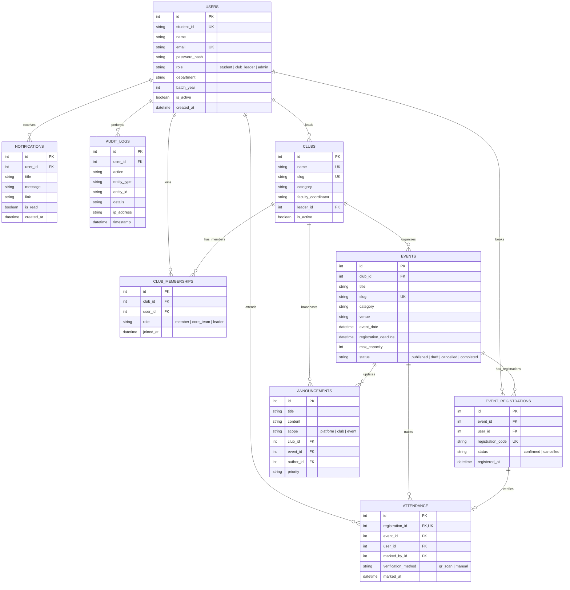

# CampusConnect — College Event & Club Management Platform

> A centralized, enterprise-grade college web platform where students discover campus events, register with capacity limits, join student societies, and receive cryptographic QR attendance passes. Club leaders coordinate events, scan attendee tickets via browser camera, and manage participants. Administrators oversee the platform with security audit logging and Power BI reporting pipelines.

---

## Table of Contents
1. [Key Features](#1-key-features)
2. [Technology Stack](#2-technology-stack)
3. [Database Architecture & ER Diagram](#3-database-architecture--er-diagram)
4. [Step-by-Step Setup Guide (Windows & VS Code)](#4-step-by-step-setup-guide-windows--vs-code)
5. [Demo User Accounts](#5-demo-user-accounts)
6. [Automated Testing Suite](#6-automated-testing-suite)
7. [Cloud Integration Guide](#7-cloud-integration-guide)
   - [Azure SQL Database Setup](#azure-sql-database-setup)
   - [Azure Blob Storage Setup](#azure-blob-storage-setup)
   - [Power BI Reporting & Analytics Pipeline](#power-bi-reporting--analytics-pipeline)
8. [QR Attendance Architecture & Security](#8-qr-attendance-architecture--security)
9. [Troubleshooting Common Issues](#9-troubleshooting-common-issues)

---

## 1. Key Features

- **Role-Based Access Control (RBAC):** Distinct dashboards and security boundaries for **Students**, **Club Leaders**, and **Administrators**.
- **Transactional Event Registration:** Database transactions check real-time seat capacity, deadline expiration, and duplicate registrations to prevent overbooking.
- **Cryptographic QR Code Attendance:** Attendance passes are generated as signed HMAC-SHA256 tokens. Organizers scan passes directly through their mobile or laptop camera using HTML5 QR scanning, verified on the backend with single-scan enforcement.
- **Manual Attendance Fallback:** Organizers can check in attendees via registration codes if cameras are restricted or phone screens are damaged.
- **Student Society Directory:** Browse active clubs, view faculty coordinators and member counts, and join/leave clubs with one click.
- **Institutional Analytics:** In-app Chart.js dashboards (registration growth, attendance rates, category distribution), CSV dataset exports, and Azure SQL reporting views ready for Power BI.
- **Security Audit Logs:** Immutable audit trail recording user logins, role changes, attendance check-ins, and event creations.
- **Offline & Cloud Ready:** Works immediately out of the box using local SQLite and local disk media storage, with instant zero-code-change switching to Azure SQL and Azure Blob Storage via `.env`.

---

## 2. Technology Stack

- **Backend:** Python 3.10+ / 3.14+, Flask 3.0, Flask-SQLAlchemy 3.1, Flask-WTF (CSRF Protection), Werkzeug (Password Hashing), ItsDangerous (HMAC Signatures).
- **Frontend:** Semantic HTML5, CSS3 Custom Properties (Modern Navy & Slate Design System), Vanilla JavaScript (ES6+), Font Awesome 6.
- **Libraries:** `qrcode` & `Pillow` (QR rendering), `html5-qrcode` (Browser camera scanning), `Chart.js` (Interactive visual analytics).
- **Database:** Azure SQL Database (Production) & SQLite (Local Fallback & Testing).
- **Cloud Storage:** Azure Blob Storage (Blob SDK v12) & local filesystem fallback.
- **Testing:** `pytest` test suite with 20 automated tests covering auth, registrations, capacity, QR check-in, and RBAC.

---

## 3. Database Architecture & ER Diagram



---

## 4. Step-by-Step Setup Guide (Windows & VS Code)

### Prerequisites
- **Python 3.10, 3.11, 3.12, 3.13, or 3.14** installed ([python.org](https://www.python.org/downloads/)).
  - *Ensure "Add Python to PATH" was checked during installation.*
- **Visual Studio Code** installed.

---

### Step 1: Open the Project in VS Code
1. Launch **Visual Studio Code**.
2. Click **File** > **Open Folder...** and select the folder:
   ```
   Final project folder
   ```
3. Open an integrated terminal in VS Code using `` Ctrl + ` `` or **Terminal** > **New Terminal** (Select **PowerShell** or **Command Prompt**).

---

### Step 2: Create and Activate Virtual Environment
Run the following commands in the VS Code terminal:

```powershell
# Create virtual environment
python -m venv venv

# If PowerShell restricts script execution, run:
Set-ExecutionPolicy -Scope Process -ExecutionPolicy Bypass

# Activate virtual environment
.\venv\Scripts\Activate.ps1
```
*(On Command Prompt `cmd.exe`, run `venv\Scripts\activate.bat` instead).*

You will see `(venv)` prepended to your command prompt.

---

### Step 3: Install Required Dependencies
```powershell
pip install -r requirements.txt
```

---

### Step 4: Configure Environment Settings
Copy the provided `.env.example` file to create your active `.env`:

```powershell
cp .env.example .env
```

*(By default, the application runs on a local SQLite database at `instance/campusconnect.db`. No cloud credentials are required to run or evaluate the full platform).*

---

### Step 5: Initialize the Database and Seed Demo Data
Populate the database with demo accounts, clubs, events, registrations, attendance records, and announcements:

```powershell
python seed.py
```

Output:
```
Initializing database tables...
Seeding sample users (Admin, Club Leader, Students)...
Users created.
Seeding campus clubs...
Clubs created.
Seeding campus events...
Events created.
Seeding event registrations...
Seeding attendance records...
Seeding announcements...

=======================================================
>>> CampusConnect Database Seeded Successfully!
=======================================================
Demo Credentials:
1. Administrator: admin@campus.edu   / Campus@2025
2. Club Leader:   leader@campus.edu  / Campus@2025
3. Student:       student@campus.edu / Campus@2025
=======================================================
```

---

### Step 6: Start the Flask Development Server
```powershell
python run.py
```

The application will start on:
```
* Running on http://127.0.0.1:5000
* Debug mode: on
```

Open your browser and navigate to: **`http://127.0.0.1:5000`**

---

## 5. Demo User Accounts

The login page (`/auth/login`) includes **Instant Demo Fill Buttons** so you can switch between roles with a single click:

| Role | Email | Password | Primary Capabilities |
| :--- | :--- | :--- | :--- |
| **Administrator** | `admin@campus.edu` | `Campus@2025` | User governance, lock protection, club charters, audit logs |
| **Club Leader** | `leader@campus.edu` | `Campus@2025` | Club management, create events, QR scanner, attendee CSV |
| **Student** | `student@campus.edu` | `Campus@2025` | Browse events, join clubs, transactional tickets, QR pass |
| Student 2 | `marcus@campus.edu` | `Campus@2025` | Additional student account for testing multi-user flows |
| Student 3 | `priya@campus.edu` | `Campus@2025` | Additional student account |

---

## 6. Automated Testing Suite

CampusConnect includes 20 unit and integration tests covering authentication, registration transactions, QR verification, and administrative safety guards.

To run the automated tests:

```powershell
python -m pytest -v
```

Expected result:
```
====================== 20 passed in 10.2s ======================
```

Test Breakdown:
- `tests/test_auth.py`: Registration, duplicate email check, password hashing, login/logout, role routing.
- `tests/test_events.py`: Search filters, transactional registration, duplicate prevention, capacity limits, deadline validation, seat cancellation.
- `tests/test_qr_attendance.py`: HMAC token cryptography, camera scan validation, duplicate scan rejection, event mismatch detection, manual code entry fallback.
- `tests/test_admin.py`: 403 Forbidden checks, account deactivation/reactivation, admin lockout protection, club chartering.

---

## 7. Cloud Integration Guide

### Azure SQL Database Setup
CampusConnect supports production deployment to Azure SQL Database with automatic SQLAlchemy pooling.

1. **Provision Azure SQL Database:**
   - In Azure Portal, create an **Azure SQL Database** (Serverless or General Purpose).
   - In **Set server firewall**, click **Add your client IPv4 address** and enable **Allow Azure services and resources to access this server**.
2. **Install ODBC Driver on Windows:**
   - Download and install **ODBC Driver 18 for SQL Server** from Microsoft.
3. **Run Schema Script:**
   - Execute the Azure-ready DDL script located in `sql/schema.sql` using Azure Query Editor, VS Code MSSQL Extension, or SQL Server Management Studio (SSMS).
4. **Update `.env`:**
   ```ini
   AZURE_SQL_DATABASE_URL=mssql+pyodbc:///?odbc_connect=Driver={ODBC Driver 18 for SQL Server};Server=tcp:<your-server>.database.windows.net,1433;Database=<your-db>;Uid=<your-username>;Pwd=<your-password>;Encrypt=yes;TrustServerCertificate=no;Connection Timeout=30;
   ```
5. **Restart Server:** The application will automatically connect to Azure SQL.

---

### Azure Blob Storage Setup
Event banners and club logos can be persisted in private Azure Blob Storage containers:

1. In Azure Portal, create a **Storage Account** (Standard General-Purpose v2).
2. Under **Security + networking**, click **Access keys** and copy the **Connection string**.
3. Under **Data storage**, create a container named `event-media` with **Blob** or **Private** access level.
4. Update `.env`:
   ```ini
   AZURE_STORAGE_CONNECTION_STRING=DefaultEndpointsProtocol=https;AccountName=...;AccountKey=...;EndpointSuffix=core.windows.net
   AZURE_STORAGE_CONTAINER_NAME=event-media
   ```
*(If left empty, CampusConnect automatically saves uploads to the local `/uploads` directory).*

---

### Power BI Reporting & Analytics Pipeline
CampusConnect is architected for institutional accreditation and dean-level participation reporting:

#### Method 1: DirectQuery to Azure SQL (Recommended)
1. Open **Power BI Desktop**.
2. Select **Get Data** > **SQL Server**.
3. Enter your Azure Server (`<server>.database.windows.net`) and Database name.
4. Select **DirectQuery**.
5. Import the reporting views pre-compiled in `sql/analytics_views.sql`:
   - `vw_EventPerformance`: Registrations, capacity fill rates, attendance % per event.
   - `vw_ClubEngagement`: Member growth, events hosted, engagement volume.
   - `vw_StudentParticipationTranscript`: Student participation transcripts.
   - `vw_DepartmentEngagement`: Cross-department athletic and technical involvement.

#### Method 2: CSV Data Pipeline
Organizers and department heads can navigate to the **Analytics Dashboard** (`/analytics`) and click:
- **Download Registrations CSV**
- **Download Attendance Records CSV**
- **Download Clubs Summary CSV**

These files can be imported into Power BI Desktop or Microsoft Excel for pivot tables and charts.

#### Method 3: Power BI Service Embedded Dashboard
To render an interactive Power BI report inside the web application:
1. Publish your report to **Power BI Service**.
2. Click **File** > **Embed report** > **Website or portal**.
3. Copy the secure embed link and set in `.env`:
   ```ini
   POWER_BI_EMBED_URL=https://app.powerbi.com/reportEmbed?reportId=...
   ```

---

## 8. QR Attendance Architecture & Security

CampusConnect prevents attendance fraud through server-side cryptographic verification:

```
[Student Registration Confirmed]
               │
               ▼
[Generate HMAC-SHA256 Token] (Registration ID, Event ID, User ID, Salt)
               │
               ▼
[Render Base64 PNG QR Pass]
               │
               ▼
[Student Presents Pass at Entrance]
               │
               ▼
[Organizer Scans via Browser Camera (html5-qrcode)]
               │
               ▼
[POST /api/attendance/verify]
       ├── 1. Verify HMAC Signature (Reject tampered/expired tokens)
       ├── 2. Check Organizer Permission (Must lead event club or be Admin)
       ├── 3. Verify Event Scope (Reject passes for a different event)
       ├── 4. Check Registration Status (Must be 'confirmed')
       ├── 5. Check Duplicate Scan (Reject if already verified; show timestamp)
       └── 6. Record Attendance Record (Timestamp, User ID, Marker ID)
               │
               ▼
[Audio Beep & Live Confirmation Card Rendered]
```

---

## 9. Troubleshooting Common Issues

### 1. PowerShell Script Execution Error
**Symptom:** `cannot be loaded because running scripts is disabled on this system.`  
**Solution:**
```powershell
Set-ExecutionPolicy -Scope Process -ExecutionPolicy Bypass
.\venv\Scripts\Activate.ps1
```

### 2. Port 5000 Already in Use
**Symptom:** `OSError: [Errno 98] Address already in use: 5000`  
**Solution:** Specify a different port:
```powershell
$env:PORT="5050"
python run.py
```
Then navigate to `http://127.0.0.1:5050`.

### 3. Resetting the Local Database
To start fresh with clean demo data at any time:
```powershell
rm instance/campusconnect.db
python seed.py
```

---

## 10. Project Directory Structure

```
Final project folder/
├── app/
│   ├── __init__.py          # Flask application factory, filters, blueprints
│   ├── config.py            # Development, Testing, Production configurations
│   ├── models.py            # Normalized SQLAlchemy models (User, Club, Event, etc.)
│   ├── decorators.py        # RBAC security decorators (@admin_required, etc.)
│   ├── utils/
│   │   ├── qr_service.py    # HMAC token generation, verification, QR rendering
│   │   ├── storage.py       # Azure Blob storage with local disk fallback
│   │   └── audit.py         # Security and operational audit logging
│   ├── routes/
│   │   ├── auth.py          # /auth/login, /register, /profile, /logout
│   │   ├── main.py          # / (landing), /about
│   │   ├── student.py       # /student/dashboard, registrations, clubs, notifs
│   │   ├── events.py        # /events, details, register, cancel, ticket
│   │   ├── clubs.py         # /clubs, details, join, leave
│   │   ├── club_leader.py   # /club-leader/dashboard, events, participants, scanner
│   │   ├── admin.py         # /admin/dashboard, users, clubs, events, logs
│   │   ├── analytics.py     # /analytics, /analytics/export-csv
│   │   └── api.py           # REST APIs: QR verify, manual check-in, search
│   ├── templates/           # 20+ Jinja2 HTML templates
│   └── static/
│       ├── css/style.css    # Responsive modern design system
│       └── js/              # QR scanner, Chart.js analytics, main helpers
├── sql/
│   ├── schema.sql           # Azure SQL DDL (Tables, Indexes, Constraints)
│   ├── analytics_views.sql  # Power BI Reporting Views
│   └── sample_queries.sql   # Common operational & analytical queries
├── tests/
│   ├── conftest.py          # Pytest fixtures & in-memory SQLite setup
│   ├── test_auth.py         # 4 Auth & RBAC tests
│   ├── test_events.py       # 6 Event & Capacity tests
│   ├── test_qr_attendance.py# 6 QR verification tests
│   └── test_admin.py        # 4 Admin & Lockout protection tests
├── uploads/                 # Local media upload directory fallback
├── .env.example             # Template for local & Azure credentials
├── .gitignore               # Git rules for secrets, DB, and venv
├── requirements.txt         # Pinned production packages
├── seed.py                  # Database initialization & demo seed script
├── run.py                   # Development entrypoint
└── README.md                # Comprehensive documentation
```
